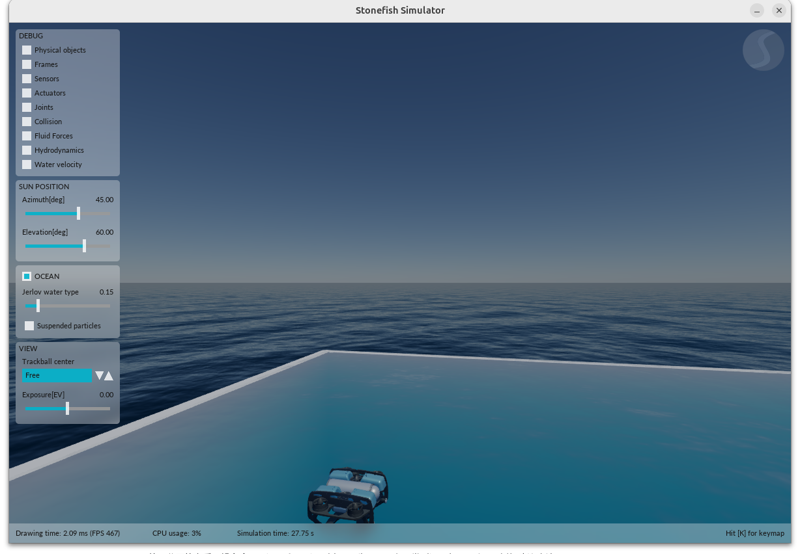

# UnderwaterObjectNav

ROS 1 Noetic + Stonefish 1.6 水下目标导航学习工程。代码以师兄整理后的 [AquaStonefishSim](https://github.com/indixi/AquaStonefishSim) `f3abe92` 为基准，保留本仓库的 Docker 环境和 [14 天学习方法](学习方法.md)。第 1–9 天的记录在 `learning/`；第十天尚在进行中。

工程包含水下场景、BricsBot/BlueROV2、推进器控制、RGB-D 采集、GFL 检测、规则专家和 BC 在线导航。规则专家是上游初版代码，运行效果需要实际验证。目标导航与连续视觉目标跟踪是不同任务。



## 目录

```text
src/
├── stonefish_ros/                   Stonefish 的 ROS 1 接口
├── aquaflow_stonefish/              场景、机器人、推进器分配
├── robot_control/                   离散动作执行器和串级 PID
└── algorithm/objectnav/
    ├── expert_data_rule/            规则专家与连续数据采集
    ├── data_generate/               RGB、Depth、Odometry 样本采集
    ├── image_process_ResNet50/      GFL 检测训练和推理
    └── ObjectNav/                   地图、BC 和在线导航

docker/                              容器镜像与运行脚本
learning/                            学习记录及实验资料
学习方法.md                           学习计划
```

ROS 包名 `objectnav` 是小写，代码目录 `ObjectNav` 是大写。旧版 `hofa_mpc_ros` 与 `aquaflow_ref` 不在当前师兄主线中。

## 环境与首次运行

需要 Linux、Docker Engine、Docker Compose v2、Docker Buildx、NVIDIA 驱动和 NVIDIA Container Toolkit；图形仿真还需要可用的 X11 显示。当前镜像默认使用 NVIDIA GPU。建议预留至少 50 GB 可用磁盘和足够内存，首次下载时间取决于网络。

```bash
git clone https://github.com/alksjzj/UnderwaterObjectNav.git
cd UnderwaterObjectNav

docker --version
docker compose version
docker buildx version
nvidia-smi
echo "$DISPLAY"

./docker/run.sh build
./docker/run.sh compile
./docker/run.sh verify
```

`build` 构建完整镜像，`compile` 用容器内系统 Python 编译 Catkin 工作空间，`verify` 检查 GPU/OpenGL、ROS、Stonefish、深度学习依赖并运行 ObjectNav 与规则专家的测试。构建使用宿主机网络与 BuildKit `network.host` entitlement，以支持本机代理；基础镜像的拉取仍使用 Docker daemon 的网络配置。网络源可覆盖：

```bash
PIP_INDEX_URL=https://pypi.org/simple \
TORCH_FIND_LINKS=https://download.pytorch.org/whl/cu121/ \
./docker/run.sh build
```

容器通过 bind mount 将当前仓库映射为 `/workspace`。系统 Python 3.8 运行 ROS Noetic 节点，Conda 环境 `objectnav-gfl` 使用 Python 3.10 运行 PyTorch、MMCV、GFL 和 BC；推理进程和 ROS 节点通过 TCP 交互。

## 仿真与控制

```bash
./docker/run.sh demo       # 空水池、BlueROV2
./docker/run.sh tracking   # BricsBot 路径控制，推进器默认禁用
./docker/run.sh shell      # 进入另一个容器终端
```

`tracking` 使用 `scene:=random_pillars vehicle_model:=bricsbot enable:=false`，用于先检查参考、里程计和控制输出。图形程序在启动终端按 `Ctrl+C` 退出。观察容器中可执行：

```bash
rosnode list
rostopic list
rostopic echo -n 1 /bluerov2/odometry  # demo
rostopic echo -n 1 /bricsbot/odometry   # BricsBot 场景
```

不同场景中的机器人和话题不同。先检查当前 ROS Master、节点和控制话题的发布者；不要同时启动两套仿真或让多个控制器竞争同一个输出话题。

## 规则专家与数据采集

规则专家的组合入口是 [continuous_expert_collection.launch](src/algorithm/objectnav/expert_data_rule/launch/continuous_expert_collection.launch)。它接收 RGB、Depth、Odometry，调用检测和地图推理，再发布离散 `ActionRequest` 并管理 episode。启动需要已训练的 GFL 检测权重；仓库不包含该权重。将权重放到仓库内可挂载的位置后，例如：

```bash
./docker/run.sh expert detector_checkpoint:=/workspace/models/BEST.pth
```

脚本会传入本镜像的 Conda 路径和环境，默认 `enable_thrusters:=false`，数据目录是 `/workspace/underwater_objectnav_dataset`。可追加 launch 参数，例如 `detector_threshold_file:=/workspace/models/echinus_threshold.json`；阈值文件可选。示例路径仅说明格式，需替换成实际存在的权重。默认配置会自动开始并连续采集，先检查参数、模型、服务和保存目录；推进器启用须自行明确设置并在合适的场景验证。

采集器与数据字段详见 [data_generate/README.md](src/algorithm/objectnav/data_generate/README.md)，规则策略详见 [expert_data_rule/README.md](src/algorithm/objectnav/expert_data_rule/README.md)。师兄原 launch 中的 Conda 默认值是其本机路径，使用本仓库脚本时已覆盖。

## BC 在线导航与模型资产

```bash
./docker/run.sh objectnav
```

此入口默认 `enable:=false` 并覆盖容器内 Conda 路径，但推理仍需模型资产。默认 BC 配置依赖：

- `src/algorithm/objectnav/ObjectNav/objectnav_bc/perception/model/best_echinus_recall_at_precision_95_epoch_5.pth`：GFL 检测权重；
- 同目录的 `echinus_threshold.json`：检测阈值；
- `src/algorithm/objectnav/ObjectNav/work_dirs/objectnav_bc/best_policy.pt`：BC 策略权重。

这些训练产物不在仓库内。`objectnav` 和 `expert` 命令支持在命令末尾追加 `roslaunch` 参数；例如 `./docker/run.sh objectnav checkpoint:=/workspace/models/best_policy.pt`。实际权重的模型结构、类别顺序与阈值必须匹配配置；仅启动进程不能证明闭环导航成功。

更多说明：[ObjectNav](src/algorithm/objectnav/ObjectNav/README.md)、[GFL](src/algorithm/objectnav/image_process_ResNet50/README.md)、[在线导航](src/algorithm/objectnav/ObjectNav/underwater_objectnav_online_usage.md)。

## 本机验证与限制

2026-10-27 在现有 Noetic/Stonefish 镜像内验证了新版源码：Catkin 编译通过并发现 6 个包；GPU/OpenGL、PyTorch 和 OpenMMLab 可加载；ObjectNav 测试 11 项、规则专家测试 10 项通过。实际启动空水池后，观察到 `/stonefish_simulator` 发布 `/bluerov2/odometry`。追踪、规则专家和 BC 在线 launch 的节点列表已解析，但这些检查不代表控制运动或模型闭环通过。

完整规则专家采集和 BC 在线导航尚未验证：缺少训练权重；旧版的测试结果和图形帧率不能直接作为新版的运行结果。

## 常见问题

- **窗口无法打开**：检查 `DISPLAY`、X11 会话和 `xhost`，并确认 NVIDIA Container Toolkit 能让容器访问 GPU。
- **找不到包或 `devel/setup.bash`**：先运行 `./docker/run.sh compile`；源码目录结构变化后需要重新编译。
- **缺少模型文件**：按上面的路径提供匹配权重，或使用 launch 参数覆盖；镜像构建不会自动生成训练产物。
- **源代码改动如何生效**：Python、launch、YAML 和 SCN 通常重启相关程序；C++、消息、服务或 CMake 改动需要重新编译并重启；Dockerfile、镜像内入口脚本或依赖变更需要重建镜像。
- **输出与本机路径**：推理 launch 的上游默认路径属于原作者机器，使用 `docker/run.sh objectnav` 或 `expert` 时会覆盖；直接运行 `roslaunch` 时需手动指定 Conda 和输出目录。

旧版本源码与原 `build/`、`devel/` 在本机迁移时保存在 `.local-backups/`，该目录不会提交；从 Git 克隆不会包含这份本地备份。
